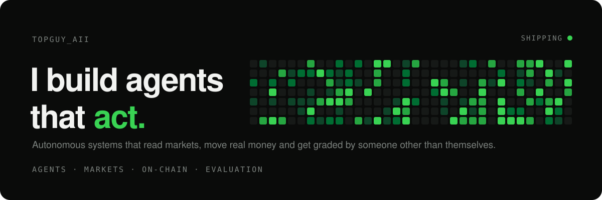

<picture>
  <source media="(prefers-color-scheme: dark)" srcset="assets/header-dark.svg">
  <source media="(prefers-color-scheme: light)" srcset="assets/header-light.svg">
  
</picture>

<br>

I build products end to end: the interface people use, the agents that think for them, the infrastructure underneath, and the proof that it all works. Most of it runs in production with real users and real money.

<br>

**What I work on**

| | |
|:--|:--|
| **AI agents** | Tool-using agents that plan, act and re-plan. Streaming answers, structured outputs, every claim grounded in data. |
| **Evaluation** | Outputs graded by independent reviewers, rewritten from critique, measured with controlled benchmarks. Agents that learn their own rules. |
| **Product** | Consumer web apps, real-time dashboards, terminals and onboarding that feels effortless. Design to deploy. |
| **Infrastructure** | Event-driven backends, job queues, indexers, scheduled workers and the observability to trust them at 3am. |
| **Payments & identity** | Passkeys, embedded wallets, smart accounts, agent payments and custody that never leaves the owner. |
| **On-chain** | Smart contracts, real-time chain indexing and execution across EVM and Solana. |

<br>

**How I work**

```
ship small, ship daily
measure it, then publish the result
an agent should never grade itself
real users, real money, real logs
```

<br>

**Stack**

| | |
|:--|:--|
| **Languages** | `TypeScript` `JavaScript` `Python` `SQL` `Solidity` `Rust` |
| **AI** | `OpenAI` `Anthropic` `Kimi` `MCP` `Tool calling` `Structured outputs` `LLM evaluation` `Agent payments (x402)` |
| **Frontend** | `React` `Next.js` `Tailwind CSS` `TanStack Query` `Framer Motion` `GSAP` `Three.js` `React Three Fiber` `Vite` |
| **Backend** | `Node.js` `Hono` `Express` `Fastify` `tRPC` `FastAPI` `Zod` `Pydantic` `WebSockets` `Server-sent events` |
| **Data** | `PostgreSQL` `Neon` `Supabase` `Redis` `SQLite` `Drizzle` `Prisma` `SQLAlchemy` |
| **Jobs & events** | `Inngest` `BullMQ` `Cron workers` `Webhooks` |
| **Cloud** | `Vercel` `Cloudflare Workers` `Railway` `Fly.io` `Docker` `AWS KMS` `GitHub Actions` `Turborepo` |
| **Auth** | `WebAuthn passkeys` `Privy` `JWT` `Sign-In with Ethereum` |
| **Testing** | `Vitest` `Playwright` `Mocha` `Chai` `Foundry` `Certora` |
| **Web3** | `viem` `ethers` `wagmi` `Hardhat` `OpenZeppelin` `ERC-4337` `ZeroDev` `Solana` |

<br>

<picture>
  <source media="(prefers-color-scheme: dark)" srcset="https://raw.githubusercontent.com/topguyaii/topguyaii/output/snake-dark.svg">
  <source media="(prefers-color-scheme: light)" srcset="https://raw.githubusercontent.com/topguyaii/topguyaii/output/snake.svg">
  
</picture>

<br>

<sub>Building in public on <a href="https://x.com/topguy_aii">X</a>.</sub>
